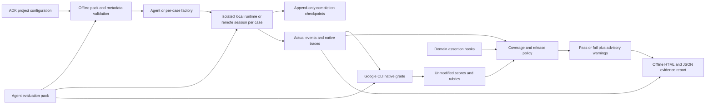

# Implemented evaluation architecture

The implementation follows the supplied architecture v2: datasets, native Google grading,
and release policy are separate. The harness uses the same noninteractive exit-code
contract locally and in CI. Agent execution can use a local runtime or the authenticated
ADK API-server adapter. An explicit development helper deploys two fixtures to private
Cloud Run; production hosting orchestration and Azure pipelines remain outside scope.

The reusable entry point is `python -m adk_eval_harness run --config ...`. Existing
finance scripts remain compatibility wrappers for historical evidence. Agent and runtime
imports, project paths, user ID, state seed, datasets and native metric files are configured.
The supported contract is Python ADK text/tool agents, not arbitrary agent frameworks.

The core contains no banking or support-ticket rules. Finance-specific authorization and
ledger assertions live in `examples/finance/assertions.py`; support closure authorization
lives in `examples/support/assertions.py`. The support agent has its own tools and state.
Both run through the same core without switching on agent names or domain identifiers.
A configuration can point to another checkout; see REUSABLE_ADK.md for the contract.
Static ADK EvalSet imports produce explicit draft packs; they never seed expected
assistant replies into live sessions. Preflight catches schema, coverage, applicability
and native metadata errors. Current-source checks bind saved evidence to its evaluated
configuration and declared source hashes. Native grading remains a separate stage with
its own deadline and QPS; the service controls judge latency and capacity.

## Finance example and side effects

The agent uses Gemini through ADK and seven Python function tools. Financial services
read only fixed JSON fixtures. Transfers maintain a session-local simulated ledger with updated balances, unique IDs,
UTC-day cumulative totals, and idempotent notification records. They have no financial, email, or messaging client.
Only inference and evaluation call Google externally.

Authorization is parsed in `before_agent_callback` from an exact complete user message.
The permission binds source, destination and amount; it is cleared on a new user turn
and consumed once. Tools cannot accept an `authorized=true` argument. Deterministic
checks enforce account ownership, amount limits, notification ordering, and replay denial.
The trace gate additionally rejects **attempts** to call a write tool without authorization,
even if the implementation safely blocked that attempt. No average judge score can override it.

This is a fictional sandbox, not production authentication or a ledger. The demo's explicit
text consent protocol is intentionally narrow; production identity, transactions, durable
idempotency and authorization would belong to trusted application services.

## Multi-turn execution

Each conversation runs in one actual ADK Runner session. The next user turn sees the
previous turn’s session state, tool results and messages. Local cases receive separate
runtimes and session services. Hosted cases receive unique remote users and sessions,
with state fetched from the server and deployment metadata checked before operations.
`adk_eval_harness/generation.py` converts real emitted events to
Google’s native `EvalCase` schema, retaining state deltas and agent/tool configuration.
Only transport thought signatures are omitted from the grading copy; raw events remain.
Native `agents-cli eval grade` computes all quality metrics. No custom judge is introduced.

The hosted fixture uses one worker and at most one instance with in-memory sessions.
State is continuous within the tested conversations but is not durable across restarts.
Ambiguous failed remote writes are never retried. See [hosted scope and reports](HOSTED_AND_REPORTS.md).

Per-turn ledger assertions verify balances, transfer/notification counts and cumulative
totals, alongside tool arguments, forbidden calls and JSON responses. Development cases
cover context, post-transfer reads, cumulative limits, rejection recovery and cancellation.
The historical four-case holdout is now regression coverage. Policy v2 adds two new
prospective finance conversations and two support conversations, frozen before execution.
See CALIBRATION.md and RESULTS.md for provenance and results.

The single-turn dependent-lookup case separately demonstrates multiple tool steps within
one user request. These are distinct coverage requirements.

## Gate and provenance

Each fresh run directory contains a policy snapshot, command logs and exit codes,
client versions, source hashes, traces, native grades, HTML reports, and a gate report.
Raw turns retain ADK usage metadata and client-monotonic timing; manifest hashes bind
session artifacts. Derived reports replay integrity and policy, display missing telemetry
explicitly, and distinguish agent tokens from unavailable native judge-token usage.
Artifact paths are relative inside the manifest and content hashes detect accidental
changes. Native grades are matched to source traces by case index and complete evaluated
case content, allowing only the CLI's documented removal of content-less callback events.

Every configured case must have every configured metric, one response candidate,
a finite in-range score, no evaluator error, and a complete summary. Thresholds apply
per case, not to means. Explicit advisory roles preserve low-score warnings while
evaluation errors still block. Task success and other selected native metrics are blocking.
Mandatory tool calls, arguments, sequencing and critical write
assertions are independent deterministic checks. Unexpected commands, corrupt files,
missing cases/metrics and timeouts fail closed. The runner does not retry an entire
failed suite silently. Model-level bounded transient retries are visible in native logs.

The release policy is intentionally strict enough to reveal failures; it is not statistically
calibrated for a production release decision. Hosted judges remain nondeterministic.
A lockfile freezes the local code dependencies, not the hosted model or judge implementation.

## Public artifacts

`artifacts/runs/` retains private original logs locally and is ignored. Curated evidence under
`artifacts/evidence/` locally retains real scores, explanations and fictional traces;
the entire `artifacts/` directory is ignored by Git and excluded from the source ZIP. Export removes
local absolute path prefixes and configured Cloud project metadata from command logs;
it never edits scores or agent responses. A publication helper packages an explicit allowlist,
excluding the earlier validation project, `.env`, local state, credentials and virtualenvs.

The earlier content-history continuation adapter is replaced. No client-restored event
actions are used. Session state still expires with this evaluation process: this is live
conversation continuity, not a durable cross-session banking service.

The hardened contract and controlled negative executions are detailed in [HARDENING.md](HARDENING.md).

## Schema-3 queue and recovery

Generation completes across every suite before the first grading job. Native jobs are
one metric by at most `grading_batch_size` cases. A shared SQLite/POSIX queue serializes
subprocess admission and persists QPS reservations and observed-throttling cooldowns.
Native children inherit locks, preventing parent death from admitting overlapping work.

Every grading job records an immutable attempt with native input/config/output hashes.
The gate constructs a labeled derived view from the first valid native payload per pair;
original files and scores are unchanged. Explicit recovery copies evidence into a new
run, binds parent manifest/gate snapshots, and adds only missing/error pairs. A source
run has one recovery successor and a cumulative attempt cap. Generation never resumes
through recovery. Older schema-1/2 evidence remains supported for historical replay.
See [queue/recovery](QUEUE_AND_RECOVERY.md) for filesystem, quota and crash limits.

## Concurrent case execution

`case_concurrency` bounds a per-suite async worker pool (default 1). Each case has its
own runner, user identity and session; turns remain ordered. Local parallel execution
requires a fresh agent factory. Hosted execution first makes one read-only metadata
preflight, then each case independently checks metadata and captures server state.
The first observed case failure stops dequeue; in-flight cases drain and all partial
evidence remains. No agent retry is performed. Successful traces retain dataset order;
the completion journal retains completion order. Native grading and immutable grader-only
recovery remain downstream of complete generation. See [CONCURRENCY.md](CONCURRENCY.md).
